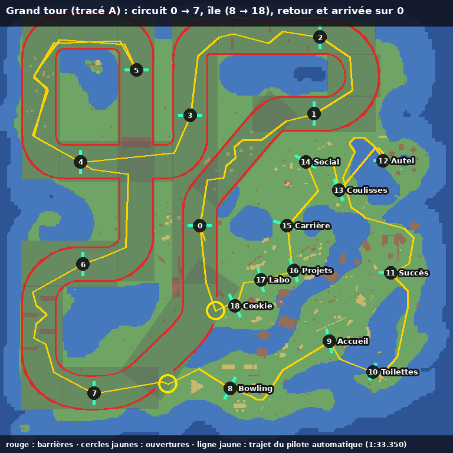

# BS Folio Race — édition speedrun / TAS

Version jouable hors ligne de la course du [portfolio 2025 de Bruno Simon](https://github.com/brunosimon/folio-2025) (licence MIT), pour Linux et Windows, avec un **éditeur TAS** intégré.

- Le jeu démarre directement à côté du circuit.
- Deux épreuves : le **Circuit** d'origine (~35 s) et le **Grand tour** : un tour du circuit puis toute l'île (20 portes, ~1 min 30 à 2 min).
- **F9** bascule entre le jeu normal et l'éditeur TAS.
- **F10** (ou menu ☰ → Options → Touches) : changer les touches du clavier.
- F11 : plein écran · F12 : outils de développement.

## Lancer

| Système | Fichier | Commande |
|---|---|---|
| Windows | `BS-Folio-Race-<version>-win-x64.zip` | dézipper, lancer `BS Folio Race.exe` |
| Linux | `BS-Folio-Race-<version>-x86_64.AppImage` | `chmod +x` puis `./BS-Folio-Race-…AppImage` (sous WSL : ajouter `--appimage-extract-and-run`) |

Options : `--tas` (ouvrir directement l'éditeur), `--debug` (panneau de réglages du jeu), `--webgpu` (Linux : tenter WebGPU au lieu de WebGL2).

## Touches (jeu normal)

**F10**, ou le menu ☰ → Options → « Touches », ouvre la fenêtre des touches : cliquez sur une case puis appuyez sur la nouvelle touche (Échap : annuler, Retour arrière : vider la case, « Réinitialiser » : touches d'origine). Deux touches par action : avancer, reculer, gauche, droite, boost, frein, saut, replacer la voiture, recommencer la course, klaxon.

- Une touche ne sert qu'à une action : la donner à une action la retire des autres. Exception : « Replacer la voiture » (balade) et « Recommencer la course » (course) peuvent partager la même touche, comme R à l'origine.
- Si le jeu se sert déjà de la touche pour autre chose (M pour la carte, par exemple), la fenêtre le signale.
- Échap, F9, F10, F11 et F12 sont réservées.
- Les touches de conduite sont **communes avec l'éditeur TAS** (enregistrement) : les changer ici ou dans les réglages de l'éditeur (⚙) revient au même. La manette n'est pas modifiée.
- Elles sont enregistrées sur l'ordinateur et gardées d'une version à l'autre.

## Les épreuves

### Circuit
La course d'origine : 8 portes, 1 tour, sur la route du circuit avec ses barrières. Point de départ : « Start race! ».

### Grand tour (tracé A, depuis 1.4.0)
Un tour complet du **circuit, avec ses barrières** (portes 0 à 7), puis on sort sur l'île par une **ouverture dans la barrière juste après la porte 7**, on passe **une porte par zone**, et on rentre sur le circuit par une **seconde ouverture juste avant la ligne** pour l'arrivée :

Circuit 0 → 7 → *sortie* → Bowling → Accueil → Toilettes → Succès → Autel → Coulisses → Social → Carrière → Projets → Labo → Cookie → *entrée* → **arrivée sur la ligne de départ**.



- Départ : le point « **Grand tour!** », juste à côté de « Start race! » (6 m plus loin).
- **Ordre imposé** : seule la prochaine porte est active (surlignée) ; une porte franchie dans le désordre ne compte pas.
- **Guidage** (depuis 1.4.1) :
  - en haut à gauche, le nom de la prochaine porte et la distance qui reste, en suivant le trajet praticable ;
  - une **flèche au sol** autour de la voiture, dès la sortie du circuit : elle montre la direction à prendre en suivant un trajet praticable (elle contourne l'eau et les bâtiments) et s'efface quand la porte est à moins de 14 m ;
  Tout cela n'est que de l'affichage : les movies restent valables.
- Le compteur affiche `portes franchies / 20` et, dans l'éditeur, le nom de la prochaine porte.
- Hors du circuit, on roule librement sur l'île. L'eau peu profonde ralentit fortement mais ne fait pas perdre (Autel, bras d'eau vers les Toilettes). En eau profonde, ou dans le gouffre de l'Autel, la voiture est replacée devant la dernière porte franchie.
- Pendant la course, les étiquettes des zones sont masquées et les caisses explosives collées à une porte sont retirées (5 caisses).
- Le classement en ligne et le succès « circuit rapide » restent réservés au Circuit.
- Temps de référence : `grand-tour-demo-pilote-auto.json`, un movie produit par un pilote automatique (suivi de trajectoire, sans optimisation) : **1:33.350**. Il est battable, il sert de premier objectif et de preuve que le parcours se boucle.
- Les movies du Grand tour faits avec la 1.3.0 (ancien tracé, sans barrières) ne se rejouent plus : l'éditeur prévient à l'ouverture.

## L'éditeur TAS

En mode TAS, le jeu est **entièrement déterministe**. Les mêmes entrées donnent toujours exactement la même course, au bit près, et un movie se rejoue à l'identique dans l'éditeur, après n'importe quel retour en arrière, et dans une autre instance du jeu. Pour y arriver, le mode TAS :

- fait avancer le jeu image par image (60 images/s) en temps virtuel : boucle principale, animations gsap, `Date.now`, `setTimeout` et `setInterval` ;
- utilise un hasard à graine fixe, avec une source séparée pour les sons et l'interface ;
- coupe le jeu du clavier, de la souris et de la manette : l'éditeur lit les touches lui-même et le jeu ne reçoit que les entrées du movie, par le même chemin en enregistrement et en relecture ;
- utilise la version **déterministe** du moteur physique Rapier (`@dimforge/rapier3d-deterministic`, même version 0.17.3). Avec la version standard, recharger un savestate ne redonne pas exactement le même état. La version déterministe garantit aussi les mêmes résultats entre Windows et Linux. Le jeu normal (hors mode TAS) garde le Rapier d'origine.

L'**image 0 est l'image du départ** : le chrono vaut 00:00.000 juste avant elle, et l'entrée 0 s'applique à l'image même où il démarre. Il avance ensuite de 1/60 s par image et correspond exactement au chrono du jeu.

En lecture depuis l'image 0, ou dès que REC est actif, un **compte à rebours** (3, 2, 1, GO, avec bips) précède le départ, pour démarrer pile au bon moment. Sa durée se règle dans ⚙ (0 pour le désactiver).

### Raccourcis

Tous les raccourcis de l'éditeur, ainsi que les touches de conduite utilisées en enregistrement, se modifient dans les **réglages** (bouton ⚙ ou F10) : « Modifier », puis appuyez sur la nouvelle touche. Une touche déjà prise est retirée de l'autre action. « Réinitialiser » rétablit les valeurs ci-dessous. Les lettres sont reconnues par leur caractère : Ctrl+Z fonctionne aussi en AZERTY.

| Touche (par défaut) | Action |
|---|---|
| F2 | Lecture / pause (à la vitesse choisie) |
| F4 | Image suivante (maintenir : avance image par image) |
| F3 | Image précédente (maintenir : rembobiner) |
| F5 | Enregistrement ON/OFF : vos touches (flèches/ZQSD, Maj, B, Espace, pavé numérique…) sont écrites dans le movie à chaque image jouée |
| F6 | Retour au départ |
| F7 / F8 | Ralentir / accélérer la lecture (×0,05 à ×4) |
| Ctrl+Z / Ctrl+Y | Annuler / rétablir |
| Inser / Suppr | Insérer une image neutre / supprimer l'image courante |
| Ctrl+S / Ctrl+O | Enregistrer / ouvrir un movie (`.json`) |
| F10 | Réglages (raccourcis, touches de conduite, compte à rebours) |
| F1 | Aide (affiche les raccourcis actuels) |
| F9 | Retour au jeu normal (non modifiable) |

### Édition à la souris

Chaque ligne de la liste correspond à une image : **Gaz** (▲ avant, ▼ arrière, · rien), **Direction** (barre de gauche à droite, de -1 à +1), **Bst** (boost), **Frn** (frein), **Saut** (suspensions hautes).

- Clic : modifier. Pour la direction, la valeur dépend de l'endroit du clic (bord gauche = plein gauche, centre = tout droit).
- Glisser : peindre plusieurs images d'un coup.
- Clic droit sur Direction : remettre à 0.
- Molette : ±1 image (Maj : ±10). La barre de temps permet de sauter n'importe où.

Quand vous modifiez une image passée, la course est **recalculée exactement** à partir du dernier savestate. Un savestate est pris automatiquement toutes les 20 images (point vert dans la liste), et d'autres, plus rapprochés, autour du curseur pendant que vous rembobinez.

### Méthode conseillée

1. En pause, activez **REC** (F5), maintenez les touches voulues et avancez avec **F4**. Vous pouvez aussi enregistrer en lecture continue au ralenti (F7 puis F2).
2. Revenez en arrière avec **F3** ou la molette pour corriger : la suite du movie est conservée.
3. Affinez image par image à la souris.
4. À l'arrivée, le temps final et l'image d'arrivée s'affichent. Enregistrez avec Ctrl+S.

Le movie en cours est aussi sauvegardé automatiquement (et restauré au prochain lancement de l'éditeur), **un par épreuve** (et un par version du tracé du Grand tour).

### Choisir l'épreuve
Le menu déroulant en haut de l'éditeur bascule entre **Circuit** et **Grand tour** (l'éditeur se recharge, le movie en cours est sauvegardé). Ouvrir un movie d'une autre épreuve bascule automatiquement sur la bonne. En ligne de commande, l'adresse interne contient `&course=tour`.

### Format des movies

```json
{
  "format": "bs-folio-tas-movie", "version": 2, "game": "brunosimon/folio-2025", "course": "tour", "track": 2, "fps": 60,
  "result": { "frames": 1652, "time": 27.533, "timings": [ … ] },
  "inputs": [ [ gaz, direction, boost, frein, "suspensions" ], … ]
}
```

- `course` : `"circuit"` ou `"tour"` (absent = circuit, pour les anciens movies).
- `track` : version du tracé du Grand tour (`2` = tracé A depuis 1.4.0 ; absent = ancien tracé 1.3.0).
- Version 2 : l'entrée 0 est celle de l'image du départ. Les movies en version 1 (éditeur 1.1.0) restent lisibles : une image neutre est ajoutée au début à l'ouverture, pour garder le même timing.
- `gaz` : -1 à 1.
- `direction` : -1 à 1 ; **+1 = gauche**, -1 = droite (convention du jeu).
- `boost`, `frein` : 0 ou 1.
- `suspensions` : `""` (normal) ou 4 lettres `l`/`m`/`h` (bas/milieu/haut) pour avant-droite, avant-gauche, arrière-droite, arrière-gauche ; `"hhhh"` = saut.

## Reconstruire

```bash
./build.sh            # clone folio-2025, applique patches/folio-2025-tas.patch, compile, emballe
```

Le correctif `patches/folio-2025-tas.patch` ajoute `sources/Game/Tas.js` (mode déterministe, savestates), `sources/Game/TasEditor.js` (interface), `sources/Game/KeyBindings.js` (touches du jeu normal) et `sources/data/grandTour.js` (portes et ouvertures du Grand tour), modifie `World/Areas/CircuitArea.js` (deux épreuves, barrières avec ouvertures), `World/Areas/AltarArea.js` (gouffre de l'Autel pendant une course) et `World/ExplosiveCrates.js` (caisses retirées) et quelques lignes de `index.js`, `Rendering.js` et `Game.js` (Rapier déterministe en mode TAS, fenêtre des touches). Il s'applique sur le commit indiqué dans `patches/UPSTREAM_COMMIT`.

Les exécutables (> 100 Mo) se publient dans les **Releases** GitHub, pas dans le dépôt.

## Outils (facultatif)

Le dossier `tools/` contient le pilote sans affichage (Chromium + Playwright) utilisé pour les tests de déterminisme. Il servira de base à l'optimisation automatique :

```bash
cd tools && npm install playwright && npx playwright install chromium
node determinism.mjs ../../folio-2025/dist     # même movie, deux instances → trajectoires identiques ?
node savestate-test.mjs ../../folio-2025/dist  # savestates et retours en arrière → identique au run continu ?
```

### Recalculer le Grand tour (`tools/grand-tour/`)

Chaîne utilisée pour placer les portes et vérifier que le parcours est faisable :

```bash
cd tools/grand-tour && npm install playwright
node geom.mjs                       # géométrie de la route et des portes du circuit → circuit-geom.json
python3 gen_tour_a.py tangents      # portes, ouvertures et trajet de guidage (path.json) → sources/data/grandTour.js (puis recompiler)
node map2.mjs                       # relevé de l'île en course (route, terrain, barrières, obstacles, 0,5 m) → map-a.json
python3 path_a.py                   # trajet A* porte à porte, en passant par les ouvertures → path.json, tangents_a.json
python3 render_a.py carte.png       # image de contrôle (barrières, portes, trajet)
python3 trace_a.py trace.png        # image du mode d’emploi
node drive.mjs 6 2.2 0.35           # pilote automatique → autopilot-tour.json
node verify.mjs <movie.json>        # relecture dans une instance neuve → même temps ?
```

Les scripts cherchent le jeu compilé dans `../folio-2025/dist` (à côté du dossier BSRace) ; sinon, indiquez-le avec `FOLIO_DIST=…` (et `FOLIO_SRC=…` pour les sources).

Attention : modifier les portes ou les ouvertures rend les movies Grand tour existants invalides (pensez à augmenter `TRACKS.tour` dans `TasEditor.js`). La version livrée est celle de `sources/data/grandTour.js`.

## Licences

Jeu : © 2025 Bruno Simon, licence MIT (`LICENSE-folio-2025.md`). Emballage et éditeur TAS : MIT.
